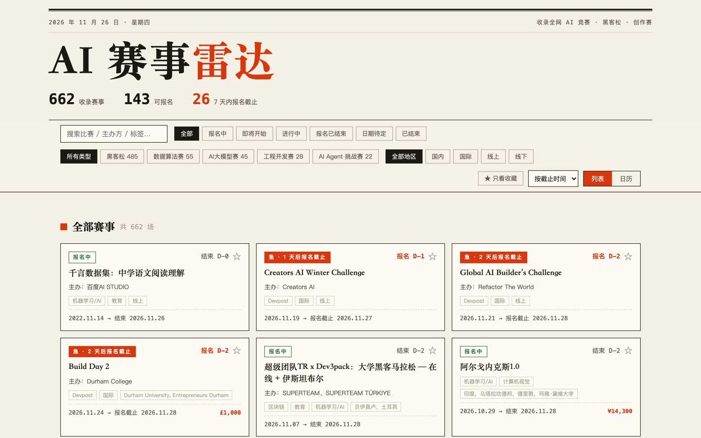

<div align="center">

# AI 赛事雷达

**聚合全网国内外 9 大平台的 AI 竞赛 / 黑客松 / AIGC 创作赛日历，每日自动更新，打开网页即看。**

[](https://ye4wzp.github.io/ai-contest-radar/)
[](https://github.com/ye4wzp/ai-contest-radar/actions/workflows/update-data.yml)
[](#覆盖数据源)

**[立即打开在线网页 → https://ye4wzp.github.io/ai-contest-radar/](https://ye4wzp.github.io/ai-contest-radar/)**

<p></p>

</div>

## 界面预览



## 亮点特性

- **每日自动抓取与去重**：GitHub Actions 每天北京时间约 07:17 自动拉取 9 大平台最新赛事、合并去重并刷新静态页（GitHub 定时任务可能有轻微延迟）。
- **多维筛选与实时状态**：按「报名中 / 即将开始 / 进行中 / 已结束」、赛道类型（黑客松 / 数据算法 / 大模型 / 工程开发 / AI Agent）、国内/国际、线上/线下快速过滤，前端实时计算截止倒计时（`D-1`、`7 天内报名截止` 等）。
- **列表 & 日历双视图 + 本地收藏**：支持按截止时间排序、切换日历视图，点 `☆` 即可本地收藏关注赛事并用「★ 只看收藏」一键筛选。
- **飞书截止提醒**：Fork 后填一个飞书机器人 Webhook，每天自动推送 `7 / 3 / 1 / 0` 天后截止的比赛清单与抓取异常告警。
- **零后端纯静态**：打开浏览器即用，无登录门槛，也可免费部署到你自己的 GitHub Pages。

## 覆盖数据源

| 数据源 | 覆盖范围 | 采集方式 |
| --- | --- | --- |
| **阿里云天池** | 国内数据算法 / AI 大模型竞赛（含报名截止） | 公开 JSON API |
| **DataFountain** | 国内数据科学 / 算法竞赛 | 公开 JSON API |
| **魔搭社区 ModelScope** | 魔搭官方及合作 AI 赛事（自动过滤沙龙/训练营） | 公开 JSON API |
| **腾讯云黑客松** | 腾讯云官方黑客松赛事 | 官网抓取 |
| **AIBetas 竞赛日历** | 国内 AI 视频 / AIGC 创作赛 | 日历抓取 |
| **Devpost** | 国际 AI 黑客松 | 公开 JSON API |
| **MLH (Major League Hacking)** | 国际高校及社区黑客松 | 官网抓取 |
| **mlcontests.com** | Kaggle / Zindi / Codabench / NeurIPS 竞赛赛道 | 聚合抓取 |
| **AI 赛事通 (CompeteHub)** | 国内外 AI 赛事补充聚合（自动过滤非 AI/非赛事活动） | Patchright + 复用 `cf_clearance` |

## 飞书提醒（Fork 自部署）

1. Fork 本仓库并在 Settings → Pages 中启用 GitHub Pages（分支选 `main` 根目录）。
2. 在仓库 Settings → Secrets and variables → Actions 中添加 `FEISHU_WEBHOOK`（飞书群 → 设置 → 群机器人 → 添加「自定义机器人」，复制 webhook 地址）。
3. 配置后 GitHub Actions 每天自动推送：`7 / 3 / 1 / 0` 天截止的比赛清单，以及抓取失败告警。未配置则自动跳过。

## 数据管线（本地运行与开发）

```bash
pip install -r scripts/requirements.txt   # patchright；另需本机装有 Google Chrome
cd scripts
python3 fetch_competehub.py 50   # AI赛事通       -> data/sources/competehub.json
python3 fetch_tencent.py         # 腾讯云黑客松官网 -> data/sources/tencent.json
python3 fetch_mlh.py             # MLH 国际黑客松  -> data/sources/mlh.json
python3 fetch_mlcontests.py      # Kaggle/Zindi/Codabench/NeurIPS 竞赛赛道（经 mlcontests.com）-> data/sources/mlcontests.json
python3 fetch_devpost.py         # Devpost 上 AI 相关黑客松（公开 JSON API）-> data/sources/devpost.json
python3 fetch_aibetas.py         # 国内 AI 视频/AIGC 创作赛（aibetas.com 竞赛日历）-> data/sources/aibetas.json
python3 fetch_tianchi.py         # 阿里云天池（公开 JSON API，含报名截止）-> data/sources/tianchi.json
python3 fetch_datafountain.py    # DataFountain（公开 JSON API）-> data/sources/datafountain.json
python3 fetch_modelscope.py      # 魔搭社区赛事（公开 JSON API，滤掉沙龙/训练营）-> data/sources/modelscope.json
cd .. && python3 scripts/build_data.py
# 累积合并全部源 + manual.json 并去重 -> data/data.js；结束超 14 天的赛事移入 data/archive.json
```

### 抓取与数据约定

- AI赛事通站点有 Cloudflare 人机挑战：首次 403 时由 patchright 驾驭有头 Chrome 过一次挑战并复用 `cf_clearance`，其余请求仍走 urllib；CI 里跑在 `xvfb-run` 下。任一源抓取失败只告警，`build_data` 沿用上次已提交的源文件。
- 去重：名称相同/相近，或跨源官网链接相同即合并；AI赛事通是二手聚合（机翻名称、奖金折算成人民币），重复时以其他源的条目为主（魔搭多为转载，也排在一手源之后）。AI赛事通的条目另做过滤：Luma 活动只保留名称像比赛且与 AI 相关的；其余去掉沙龙/训练营/论坛等非比赛活动，以及标签、名称、简介都没有 AI 信号的（泛创业赛、CTF、Web3 等）。
- `data/manual.json`：手工维护的官方重点赛事（`featured: true`），条目 schema 与抓取结果一致。
- 日期字段：`start` 开始、`deadline` **报名截止**（拿不到就留空，MLH 不公布故一律留空；Devpost 取提交截止）、`end` 比赛结束；`signup`（`open`/`closed`/`upcoming`/`ended`）为源站自报的报名状态，优先于日期判定。AI赛事通的 `closeDate` 是比赛结束日而非报名截止，报名截止另从赛程正文解析。
- 状态（报名中/报名已结束/进行中/已结束等）由前端按上述字段实时计算，无需重新构建。
- 收藏：页面上点 `☆` 收藏比赛（存 localStorage），工具栏「★ 只看收藏」过滤。
